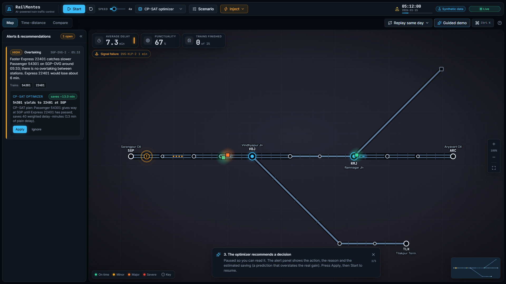
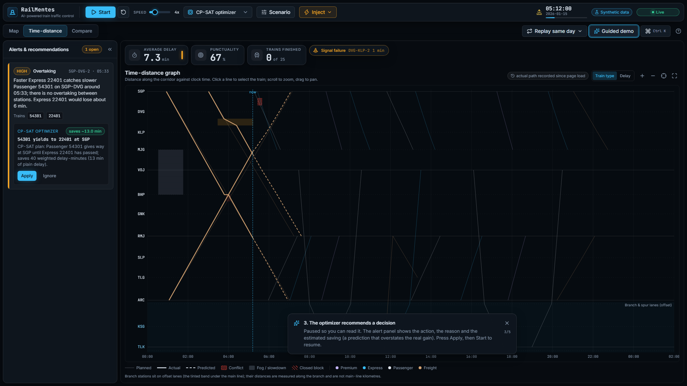
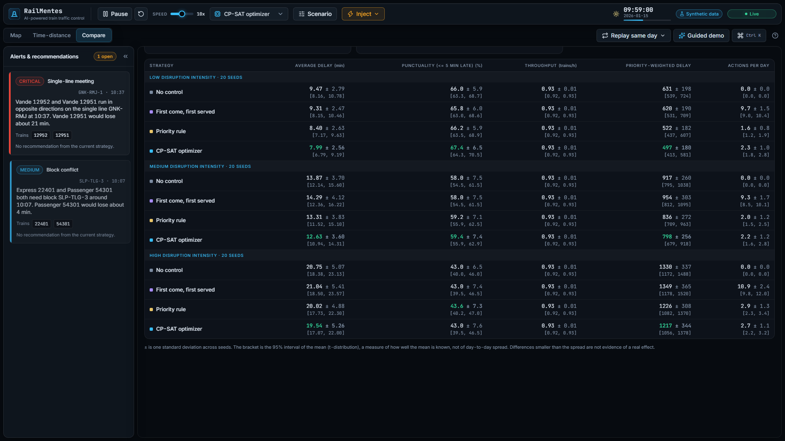
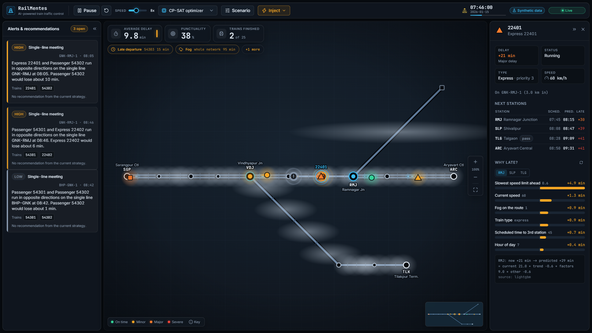
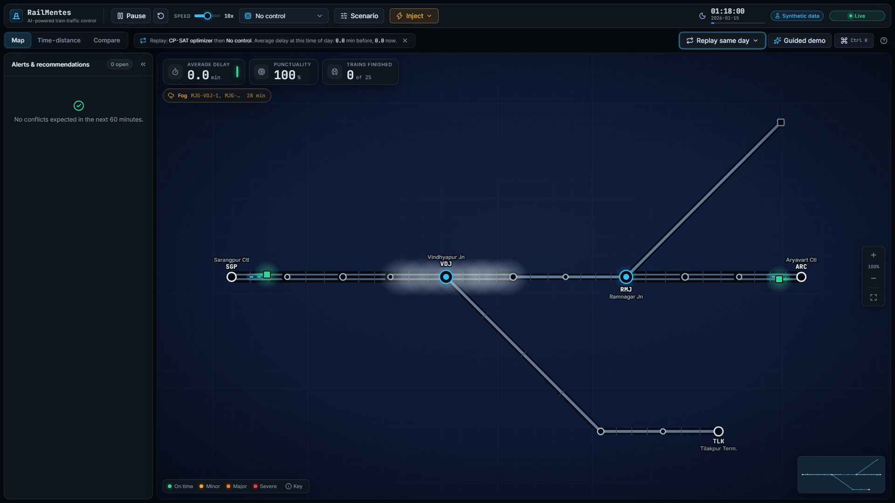

# RailMentes

**AI-powered train traffic control, simulated end to end.**

RailMentes is a live controller dashboard for a *fictional* railway corridor. The simulation moves 25 Indian-style
trains a day (premium, express, passenger, freight) over a 15-station network with single and double lines, a
junction branch and fog, signal failures and closures. On top of it an AI layer predicts train delays with
LightGBM and explains them with SHAP, detects conflicts up to an hour ahead, and recommends holds and
precedence decisions chosen by a CP-SAT optimizer, which the controller applies or ignores. Four strategies (no
control, first-come-first-served, a priority rule and the optimizer) are compared on identical simulated days.

> **All data is synthetic and the network is fictional.** Nothing here is real Indian Railways data, nothing
> was calibrated against a real railway, and no result should be read as real-world performance. Everything was
> validated in simulation only. See [docs/LIMITATIONS.md](docs/LIMITATIONS.md).

Final-year B.Tech project by **Ritik Yadav**.



## Key results

Everything below comes from the simulator. Full tables, caveats and the reproduce commands are in
[docs/RESULTS.md](docs/RESULTS.md).

**Delay prediction** (28 test days the model never saw; mean absolute error in minutes, lower is better):

| Model | Next station | 2nd station | 3rd station |
|---|---|---|---|
| Predict the average | 12.40 | 13.00 | 13.65 |
| Ridge regression | 0.79 | 2.67 | 4.46 |
| Persistence ("stays as late as now") | 1.25 | 3.12 | 4.97 |
| **LightGBM** | **0.33** | **1.78** | **3.13** |

LightGBM beats the strong persistence baseline on MAE at every horizon, but a plain Ridge model is not far behind
and has a slightly lower RMSE for some groups (trains that really are late, disruption ahead). Part of what the model
learned is the simulator's own rules, and the test days are late March with almost no fog.

**Control strategies** (20 seeds x 3 disruption levels, ML model in the loop; mean average delay in minutes,
lower is better):

| Disruption level | No control | FCFS | Priority rule | CP-SAT |
|---|---|---|---|---|
| Low | 9.47 | 9.31 | 8.40 | **7.99** |
| Medium | 13.87 | 14.29 | 13.31 | **12.63** |
| High | 20.75 | 21.04 | 20.02 | **19.54** |

The honest reading:

- CP-SAT beats the priority rule by **0.4 to 0.7 minutes** of average delay, about 2 to 5 percent, on a day-to-day
  spread of 3 to 5 minutes. It is a real but **modest** improvement, not a transformation.
- At low and medium intensity the gain is statistically clear (paired 95% intervals exclude 0). At **high intensity
  it is not reliable** for priority-weighted delay or punctuality ("no difference" with 20 seeds).
- **Without the ML delay model CP-SAT is no better than the priority rule** (intervals include 0; punctuality is
  1.4 points worse at medium intensity). It needs good predicted times.
- First-come-first-served is no better than doing nothing: the simulator already serves trains in order of arrival.
- Punctuality (share of trains at most 5 minutes late) hardly moves for any strategy, and throughput
  (0.93 trains per hour) does not move at all.
- The "saves X min" shown on a recommendation is the optimizer's own estimate and overstates the real gain by about 1.4x.
- The guided demo uses a hand-picked day (seed 222) that shows the mechanism clearly. It is not a typical day.

Conflict detector against the simulator's own log: 98 to 100 percent of real waits were flagged in advance;
precision is 70 to 90 percent at a 15-minute look-ahead and falls to 58 to 79 percent at 60 minutes.

## Screenshots

| | |
|---|---|
|  |  |
| Time-distance graph: planned, actual and predicted paths, conflicts and fog | Compare tab: the 20-seed benchmark with mean, spread and 95% interval |
|  |  |
| Live map with an injected disruption and the "why late" drawer | Replay of the same day under another strategy |

More are in [docs/screenshots/](docs/screenshots/) and the benchmark charts in [docs/results/](docs/results/).

## Features

- **Simulation:** tick engine (1 tick = 1 simulated minute), block-section safety (one train per block, no head-on
  trains on a single line), 15-station fictional corridor, 25 trains a day, seeded and reproducible days.
- **Disruptions:** fog, weather slowdown, signal failure, block closure, late departure; random per day and
  injectable by hand from the dashboard.
- **Delay prediction:** LightGBM predicts the arrival delay at each train's next three stations; SHAP shows the
  factors in minutes ("why late") in the train drawer.
- **Conflict detection:** single-line meetings, overtaking and block conflicts, up to 60 minutes ahead, with severity.
- **Four strategies behind one interface:** no control, first-come-first-served, priority rule, CP-SAT optimizer.
  Live runs only *recommend*; the controller presses Apply or Ignore (Ignore can be undone).
- **Dashboard:** zoomable network map, time-distance graph, strategy comparison tab with live and benchmark KPIs,
  "replay same day" under another strategy, guided demo, command palette (Ctrl+K), keyboard shortcuts, dark theme,
  reduced-motion support, and an **offline demo mode** with bundled sample data if the backend is not running.
- **KPIs:** average delay, punctuality (at most 5 minutes late), throughput, priority-weighted delay, conflicts
  avoided, prediction MAE and RMSE, always compared across all four strategies.
- **Synthetic data pipeline:** generator that reuses the simulator (180 days, 37,440 rows), training, evaluation
  and a 20-seed benchmark, each one command.

## Architecture overview

```
 Browser (React + Vite + TS)                     Backend (FastAPI, one process)
 ┌──────────────────────────┐   REST commands    ┌───────────────────────────────────────────┐
 │ map | time-distance |    │ ─────────────────► │ SimulationRunner (one active scenario)    │
 │ compare | alerts | drawer│                    │   engine.step ► features ► LightGBM       │
 │ Zustand store            │ ◄───────────────── │   ► conflict detector ► Strategy.propose  │
 └──────────────────────────┘  WebSocket: one    │ KPI jobs (process pool, headless days)    │
                               snapshot per tick └───────────────────────────────────────────┘
```

Diagrams of the system, the per-tick data flow, the closed loop with the strategies and the ML training pipeline,
plus the main design decisions, are in [docs/ARCHITECTURE.md](docs/ARCHITECTURE.md). The REST and WebSocket
contract is in [docs/API.md](docs/API.md); the training data in [docs/DATA.md](docs/DATA.md).

## Tech stack

| Area | Tools |
|---|---|
| Backend | Python 3.12, FastAPI, WebSockets, Pydantic, networkx |
| ML | scikit-learn, LightGBM, SHAP, pandas, NumPy, matplotlib |
| Optimization | Google OR-Tools CP-SAT |
| Frontend | React 18, Vite, TypeScript, Tailwind CSS, shadcn/ui-style components (Radix), Framer Motion, Zustand, D3, Recharts |
| Tests and lint | pytest, vitest, ruff, eslint, tsc |
| Run | native Windows, no Docker |

## Setup from scratch (Windows, PowerShell)

Requirements: **Git**, **Python 3.12** (`python --version` must say 3.12.x) and **Node.js 20 or newer** with npm.
Nothing else: no Docker, no database server, no GPU, no internet after the installs.

### Quick way

```powershell
git clone <repository-url> RailMentes
cd RailMentes
.\scripts\dev_setup.ps1
.\start_all.bat
```

`dev_setup.ps1` creates the virtual environment, installs the backend and frontend packages, creates `.env`,
generates the training data and trains the delay model. Add `-SkipData` to skip data and model (the app then runs
with the "delay stays as now" fallback), `-RunChecks` to also run all tests and linters. Then open
<http://localhost:5173>.

### Step by step (what the script does)

```powershell
cd RailMentes

# 1. Backend: virtual environment and packages (a few minutes: LightGBM, SHAP and OR-Tools are large)
cd backend
python -m venv .venv
.\.venv\Scripts\python.exe -m pip install --upgrade pip
.\.venv\Scripts\python.exe -m pip install -e ".[dev]"
cd ..

# 2. Frontend packages
cd frontend
npm install
cd ..

# 3. Optional settings (ports, seed); the defaults work
Copy-Item .env.example .env

# 4. Generate the synthetic training data (180 simulated days, about 20 seconds)
.\backend\.venv\Scripts\python.exe scripts\generate_data.py

# 5. Train the delay model and write its metrics and plots (about 15 seconds)
.\backend\.venv\Scripts\python.exe scripts\train_model.py

# 6. Start backend (port 8000) and frontend (port 5173) in two windows
.\start_all.bat
```

Open <http://localhost:5173> and press **Start**, or try the **Guided demo** button. API docs:
<http://127.0.0.1:8000/docs>.

`data\` and `models\` are generated, not committed (a 500-row sample is in `data\sample\`). If they are missing the
app still starts: without `models\delay_model.json` the backend logs a warning and predicts "the delay stays as it is
now"; without the backend the page shows bundled sample data with an **Offline demo data** badge.

### Run the benchmark (optional)

The 20-seed benchmark behind the Compare tab is already saved in `docs\results\`. To reproduce it (about 10 minutes
with the ML model on all CPU cores, about 4 minutes with `--no-model`):

```powershell
.\backend\.venv\Scripts\python.exe scripts\run_benchmark.py
.\backend\.venv\Scripts\python.exe scripts\run_benchmark.py --no-model
```

### Other commands

```powershell
.\backend\.venv\Scripts\python.exe scripts\run_sim.py --seed 42 --intensity medium        # one day, no server
.\backend\.venv\Scripts\python.exe scripts\compare_strategies.py --seed 42                # 4 strategies, one day
.\backend\.venv\Scripts\python.exe scripts\validate_detector.py                           # detector vs simulator
.\scripts\run_backend.ps1                                                                 # backend only
```

### Checks

```powershell
cd backend
.\.venv\Scripts\python.exe -m pytest
.\.venv\Scripts\python.exe -m ruff check app tests
cd ..\frontend
npm test            # vitest
npm run lint        # eslint
npm run build       # tsc + vite build
```

### Settings

`.env` (copied from `.env.example`) holds `SIM_SEED`, `USE_ML_MODEL`, `DELAY_MODEL_PATH`, `PRECOMPUTE_KPIS`, optional
`FRONTEND_ORIGIN`, and `BACKEND_HOST` / `BACKEND_PORT` (used only by `python -m app.api.main`; `start_all.bat` always uses
127.0.0.1:8000). If you run the backend on another address, copy `frontend\.env.example` to `frontend\.env.local` and set
`VITE_API_URL`. No secrets are used anywhere.

### Troubleshooting

- *"running scripts is disabled on this system"*: run `Set-ExecutionPolicy -Scope Process Bypass` in that window first.
- *Port 8000 or 5173 already in use*: close the old RailMentes windows (an old backend or `npm run dev` is still running). To use another backend port run `.\scripts\run_backend.ps1 -Port 9000` and set `VITE_API_URL` in `frontend\.env.local`.
- *The Compare tab says "computing"*: the four full-day strategy runs happen in background processes after start-up and
  after every reset; with the ML model this takes one to two minutes.
- *`python` is not 3.12*: install Python 3.12 and create the environment with `py -3.12 -m venv .venv`.

## Project structure

```
backend/app/
  models/        network, train types, the fictional corridor, shared Pydantic schemas
  simulation/    tick engine, block tracker, timetable, disruptions, scenarios
  ml/            features, data generator, dataset, baselines, LightGBM model, SHAP, live predictor
  optimizer/     conflict detector, strategies (no control, FCFS, priority), cpsat/, closed loop, KPIs
  api/           FastAPI app, runner, routes, WebSocket, background KPI jobs
backend/tests/   pytest
frontend/src/    React app: api, store, components (map, timedistance, compare, ui), utils, mocks
scripts/         generate_data, train_model, run_benchmark, compare_strategies, validate_detector, run_sim, dev_setup, run_backend
data/            generated data (git-ignored) and a committed sample
models/          trained model (git-ignored)
docs/            ARCHITECTURE, API, DATA, RESULTS, DEMO, VIVA, LIMITATIONS, PROGRESS, results/, screenshots/
```

## Limitations

The main ones (full list in [docs/LIMITATIONS.md](docs/LIMITATIONS.md)): trains are points without length, there are
no platform limits, the timetable is the same 25 trains every day, the data is synthetic and partly learned from the
simulator's own rules, the test days have almost no fog, the optimizer's savings are overstated by about 1.4x,
the gain over the priority rule is modest, and everything was validated in simulation only. This is a decision-support
demonstration, not a signalling system.

## Future work

- Real data: replace the generator with logs of a real corridor (and re-measure everything honestly).
- A stateful optimizer that remembers its earlier holds, and rerouting between parallel lines.
- Platform capacity, train length and acceleration in the simulator.
- Auto-apply switch for demonstrations; server-side history so a page reload keeps the recorded paths.
- Uncertainty in predictions (prediction intervals) so the optimizer can plan for the worst case.

Demo walkthrough: [docs/DEMO.md](docs/DEMO.md).
