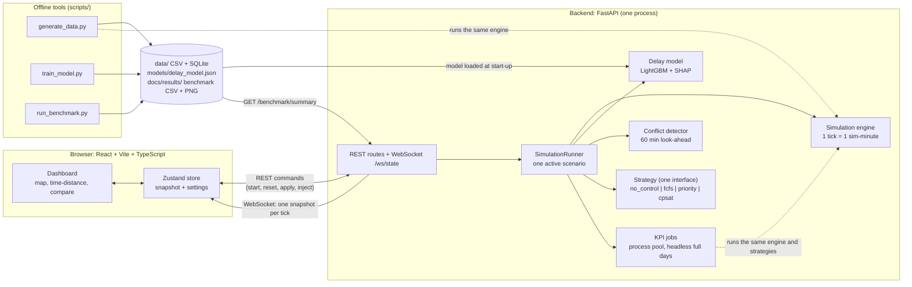
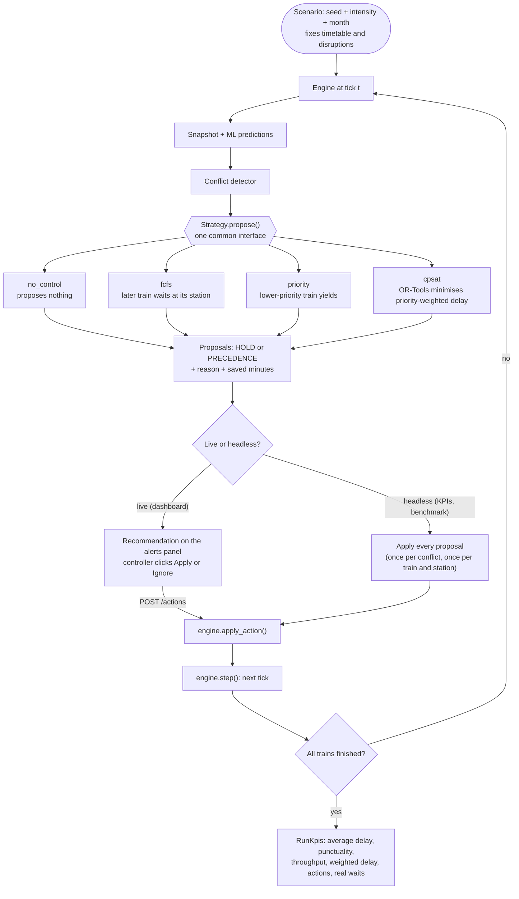
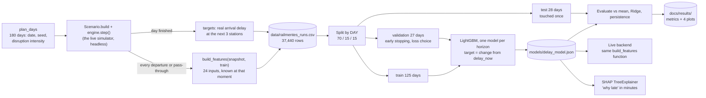

# RailMentes architecture

> All data in RailMentes is synthetic and the corridor is fictional. See [LIMITATIONS.md](LIMITATIONS.md).

The diagrams are [Mermaid](https://mermaid.js.org/); GitHub and VS Code (Markdown preview) render them.

## 1. System overview



Everything the browser shows comes from one object, the `StateSnapshot` ([API.md](API.md)). If the backend is
unreachable the page shows a bundled sample snapshot with an "Offline demo data" badge.

## 2. Data flow per tick

One tick is one simulated minute. The runner repeats this while the scenario is running (default 1 tick per
second, 0.5 to 20 selectable).

```mermaid
sequenceDiagram
    participant R as SimulationRunner
    participant E as Engine
    participant F as build_features
    participant M as DelayPredictor (LightGBM)
    participant D as ConflictDetector
    participant S as Strategy
    participant W as WebSocket clients

    R->>E: step() (apply queued actions, move trains one minute)
    R->>E: snapshot() (positions, delays, disruptions, blocks)
    R->>F: features for every train on the line
    F->>M: one feature row per train
    M-->>R: predicted delay at the next 3 stations
    Note over R: predicted_min = scheduled time + predicted delay
    R->>D: predicted snapshot
    D-->>R: conflicts in the next 60 min (who, where, when, severity)
    R->>S: propose(snapshot, conflicts)
    S-->>R: proposals (HOLD / PRECEDENCE, reason, minutes saved)
    Note over R: proposals become recommendations (status: proposed)
    R->>W: one JSON snapshot with trains, conflicts, recommendations, KPIs
    W-->>R: (clients never send over the socket; commands go through REST)
```

If there is no model file, the predictor falls back to "the delay stays as it is now" (persistence) and logs a
warning; the rest of the flow is unchanged.

## 3. The closed loop and the strategies

The same loop runs in two places: live in the runner (strategy only **recommends**) and headless in
`run_closed_loop` for the KPIs and the benchmark (every proposal is **applied**).



CP-SAT, in one picture: the detector's conflicts are split into small independent groups of trains; for each group
the solver chooses hold minutes and a "who goes first" order that gives the lowest priority-weighted predicted
delay, under safety rules (one train per block, no head-on trains on a single line, 1 minute headway, no passing
between stations, holds capped at 20 minutes). If it finds nothing it falls back to the priority rule and says so
in the reason text.

## 4. ML training pipeline



## 5. Components

| Component | Where | What it does |
|---|---|---|
| Network model | `backend/app/models/` | Stations, block sections, single or double line, train types and priorities. The fictional 15-station corridor (2 junctions, a branch, a goods yard spur, 45 blocks). `schemas.py` is the shared data contract (Pydantic). |
| Simulation | `backend/app/simulation/` | Tick engine: trains drive block by block, wait if the next block is taken, halt per type. Timetable (25 trains a day), seeded random disruptions (fog, weather, signal failure, closure, late departure), optional extra dwell time. |
| ML | `backend/app/ml/` | `features.py` (the one feature function), `datagen.py` (data generator), `dataset.py`, `baselines.py`, `model.py` (LightGBM), `evaluate.py`, `explain.py` (SHAP), `predict.py` (live predictor with persistence fallback). |
| Conflict detector | `backend/app/optimizer/conflicts.py` | Builds each train's predicted block timeline for the next 60 minutes and flags overlaps: single-line meeting, overtaking, block. |
| Strategies | `backend/app/optimizer/` | `no_control`, `fcfs`, `priority`, and `cpsat/` (problem builder, solver, strategy). All implement `Strategy.propose()`. |
| Closed loop and KPIs | `optimizer/closed_loop.py`, `kpi.py` | Runs a full day under one strategy and measures it. |
| API | `backend/app/api/` | FastAPI app, runner (owns the one active engine), REST routes, WebSocket feed, background KPI jobs, benchmark summary endpoint. |
| Dashboard | `frontend/src/` | Map, time-distance graph, comparison tab, alerts panel, train drawer, guided demo, command palette, offline fallback. |
| Scripts | `scripts/` | Generate data, train, benchmark, compare, validate the detector, set up, run. |

## 6. Key design decisions

**The data generator reuses the simulator.** The training data is produced by running the same engine that
drives the dashboard, headless, for 180 days. Delay propagation (a slow train holds up the ones behind it) therefore
comes from the rules of the simulation, not from hand-written formulas, and the training data follows the same rules
as live runs. The cost is honest and stated everywhere: a model trained and tested on the same simulator has partly
learned the simulator, not a real railway ([RESULTS.md](RESULTS.md) caveat 2).

**One shared feature function.** `build_features()` is the only code that turns a snapshot into model inputs. The
generator and the live runner both call it, so there is no train/serve skew (the model never sees inputs computed
in a different way live than in training). A test checks that a generated row equals the live features for the same
moment, and another that features contain no future information.

**Every strategy sits behind one interface.** `Strategy.propose(state, conflicts)` returns proposals; no control,
FCFS, the priority rule and CP-SAT all implement it, and the registry makes them by name. The closed loop, the
live runner, the KPI jobs and the benchmark never know which strategy they run, so adding or swapping one touches
no other file, and the comparison is fair by construction: every strategy sees only the snapshot and the detected
conflicts (a test checks that CP-SAT gets no extra information), on the same seeded day.

**Recommend-only in live runs.** In the dashboard a strategy proposes and a human presses Apply or Ignore. This is
the realistic role of decision support in train control (the controller stays responsible), and it keeps unsafe or
mistaken advice from being executed automatically. The headless comparison applies every proposal so strategies can
be measured; the consequence is that a live run is only expected to match the KPI table if every recommendation is
applied. Safety rules (one train per block, no head-on trains) live in the simulator's block tracker, not in the
strategies, so no strategy can break them.

**Determinism.** A scenario is (seed, intensity, month). The same inputs always give the same day, and CP-SAT runs
with one worker, a fixed seed and a deterministic-time limit, so a run can be replayed exactly. That is what makes
"Replay same day with another strategy" and the paired benchmark possible.

**Simple over clever.** A graph of blocks, a tick loop, one gradient-boosting model per horizon, a detector based
on overlapping time intervals, and a small CP-SAT model per group of trains. Each file is short enough to explain
in a viva.
